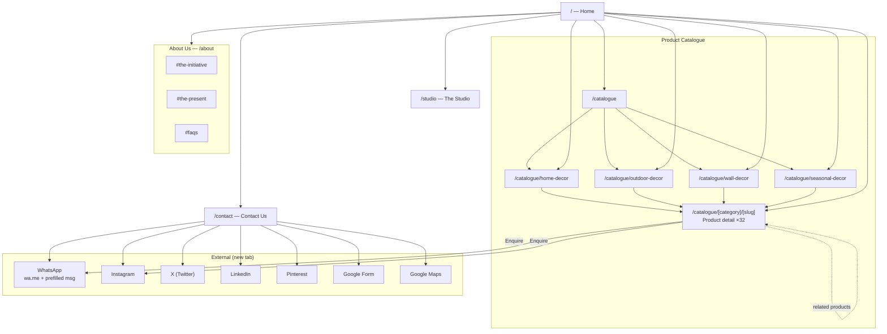

# Sitemap & Navigation

## 1. Routes

| Route | Page | Rendering | Source of content |
|---|---|---|---|
| `/` | Home | SSG | `content/pages/home.ts`, categories, featured products |
| `/catalogue` | Product Catalogue | SSG | `content/pages/catalogue.ts`, categories, all products |
| `/catalogue/home-decor` | Category | SSG (`generateStaticParams`) | `content/categories.ts`, `content/products/home-decor.ts` |
| `/catalogue/outdoor-decor` | Category | SSG | … `outdoor-decor.ts` |
| `/catalogue/wall-decor` | Category | SSG | … `wall-decor.ts` |
| `/catalogue/seasonal-decor` | Category | SSG | … `seasonal-decor.ts` |
| `/catalogue/[category]/[slug]` | Product detail (32 placeholder pages) | SSG | product + related products |
| `/studio` | The Studio | SSG (client-side animation) | `content/pages/studio.ts` |
| `/about` | About Us | SSG | `content/pages/about.ts`, `content/faqs.ts` |
| `/about#the-initiative` | About → The Initiative | anchor | |
| `/about#the-present` | About → The Present | anchor | |
| `/about#faqs` | About → FAQs | anchor | |
| `/contact` | Contact Us | SSG | `content/pages/contact.ts`, `content/site.ts` |
| any unknown path | 404 | `app/not-found.tsx` | `content/pages/not-found.ts` |
| `/sitemap.xml` | Generated | `app/sitemap.ts` | all routes above |
| `/robots.txt` | Generated | `app/robots.ts` | |

Unknown category or product slugs return a 404 (`dynamicParams = false` + `notFound()`).

**Query parameters (category pages only, client-side):** `?material=jute,cotton&colour=natural&size=large&sort=newest`. These are shareable filter states and don't create new pages. They're excluded from the sitemap and canonicalised to the bare category URL.

## 2. Diagram



## 3. Navigation structures

### 3.1 Header (all pages, sticky)

```
┌──────────────────────────────────────────────────────────────────────┐
│ [☰]                 SAI CREATIONS INTERNATIONAL               [🔍] [✉] │
└──────────────────────────────────────────────────────────────────────┘
```

| Position | Element | Behaviour | Status |
|---|---|---|---|
| Left | Hamburger button (`aria-label="Open menu"`, `aria-expanded`, `aria-controls="site-sidebar"`) | Opens sidebar | Final |
| Center | Wordmark "SAI CREATIONS INTERNATIONAL" | Link to `/` | Final; mobile lockup pending approval |
| Right | Search icon | Placeholder, non-functional | **To refine later** |
| Right | Contact icon | Links to `/contact` | **To refine later** |

Below 640px the wordmark becomes two lines (`SAI CREATIONS` / `INTERNATIONAL`). Shrink-on-scroll is controlled by the `headerShrink` flag (off).

### 3.2 Left sidebar (slide-in drawer)

```
┌─────────────────────────────┐
│                         [✕] │
│                             │
│  HOME                       │
│                             │
│  PRODUCT CATALOGUE          │
│     Home Decor              │   ← always visible, indented
│     Outdoor Decor           │     (NOT a dropdown/accordion)
│     Wall Decor              │
│     Seasonal Decor          │
│                             │
│  THE STUDIO                 │
│                             │
│                             │
│  ─────────────────────────  │
│  About Us                   │   ← pinned to bottom
│  Contact Us                 │
└─────────────────────────────┘
```

| Label | Route | Level |
|---|---|---|
| HOME | `/` | 1 |
| PRODUCT CATALOGUE | `/catalogue` | 1 |
| Home Decor | `/catalogue/home-decor` | 2 (indented) |
| Outdoor Decor | `/catalogue/outdoor-decor` | 2 |
| Wall Decor | `/catalogue/wall-decor` | 2 |
| Seasonal Decor | `/catalogue/seasonal-decor` | 2 |
| THE STUDIO | `/studio` | 1 |
| About Us | `/about` | bottom group |
| Contact Us | `/contact` | bottom group |

The current page link gets `aria-current="page"` plus the accent styling. The sidebar closes automatically on navigation.

### 3.3 Footer (all pages)

| Column | Links |
|---|---|
| **Get In Touch** | Contact Us → `/contact` |
| **Product Catalogue** | Product Catalogue → `/catalogue`; Home Decor; Outdoor Decor; Wall Decor; Seasonal Decor |
| **The Studio** | The Studio → `/studio` |
| **About Us** | About Us → `/about`; The Initiative → `/about#the-initiative`; The Present → `/about#the-present` |
| **Contacts** | Icon links (new tab, `rel="noopener noreferrer"`, `aria-label`): Instagram, X (Twitter), LinkedIn, Pinterest, WhatsApp |
| **FAQs** | Accordion with FAQs where `showInFooter = true`, plus a "View all FAQs" link → `/about#faqs` |
| **Bottom strip** | Logo · © {current year} SAI Creations International · placeholder address |

Footer layout: 1 column (stacked) on mobile → 2 columns at `md` → link columns in one row with the FAQ accordion spanning full width below at `lg`.

## 4. Breadcrumbs

Shown on category and product pages (and emitted as `BreadcrumbList` JSON-LD):

- `Home / Product Catalogue / Home Decor`
- `Home / Product Catalogue / Home Decor / Jaipur Block-Print Cushion Cover`
